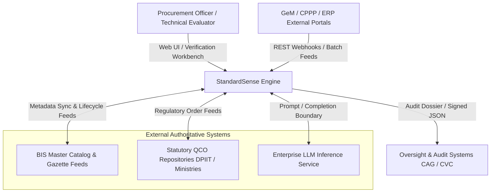
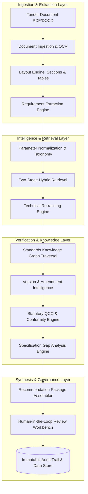
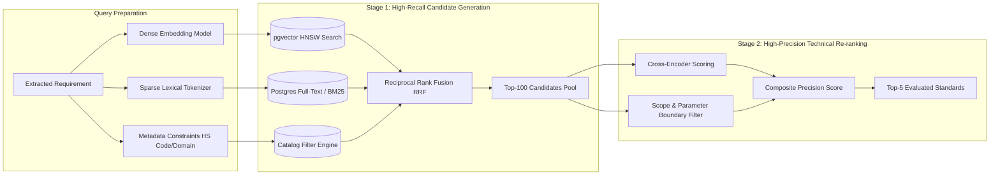
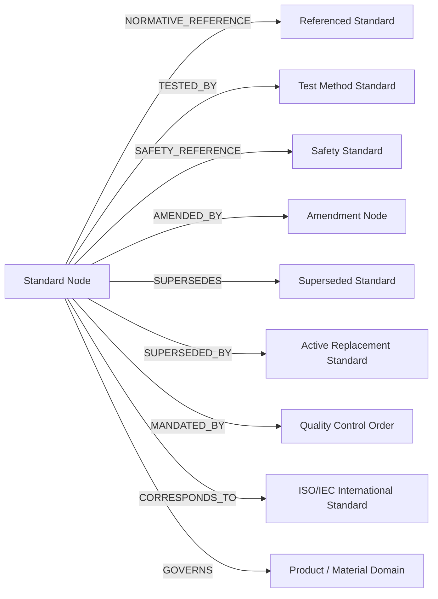
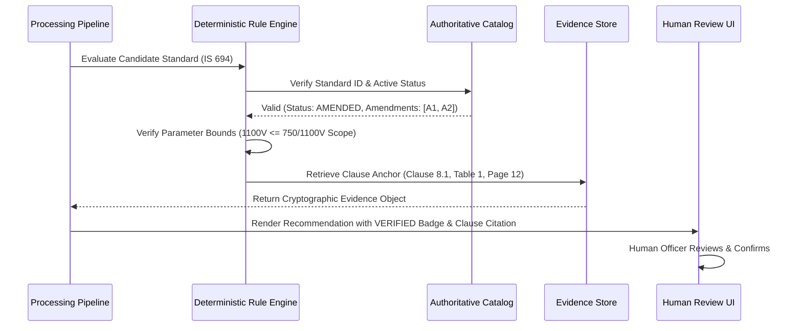
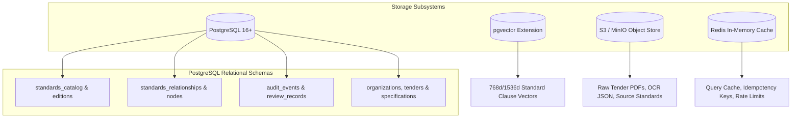
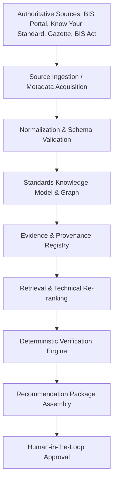
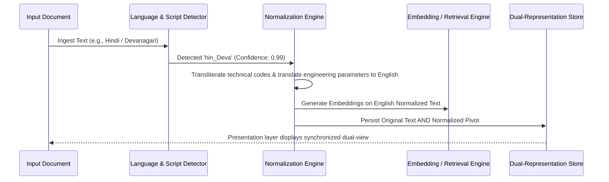

# StandardSense: System Architecture Specification
## Engineering Blueprint for an Evidence-First Procurement Standards Intelligence Engine

---

### Document Control
- **System Name**: StandardSense Engine
- **Document Version**: 1.0.0-PROPOSED
- **Status**: Foundational Technical Architecture
- **Companion Document**: [PRODUCT_SPEC.md](PRODUCT_SPEC.md)
- **Primary Proving Ground**: SIH26108 — AI-Powered Recommendation Engine for Identifying Applicable Indian Standards for Procurement Specifications
- **Architectural Paradigm**: Modular Monolith with Hexagonal Domain Boundaries (Ports & Adapters)

---

## 1. Architectural Overview & Design Philosophy

### 1.1 Core Engineering Mandate
StandardSense is engineered to solve a mission-critical reliability problem in technical public and industrial procurement: how to automatically, accurately, and traceably map complex procurement specifications to governing technical standards, regulations, and conformity requirements without hallucination, legal exposure, or architectural fragility.

The system's north-star operational principle is:

$$\mathbf{AI\ Finds} \longrightarrow \mathbf{Rules\ Verify} \longrightarrow \mathbf{Sources\ Prove} \longrightarrow \mathbf{Human\ Approves}$$

```
+----------------------------------------------------------------------------------------------------+
|                               THE STANDARDSENSE TRUST BOUNDARY                                     |
+----------------------------------------------------------------------------------------------------+
| PROBABILISTIC SUBSYSTEMS (AI / LLMs / Embeddings)                                                  |
| - High-Recall Candidate Retrieval & Query Expansion                                                |
| - Multilingual Natural Language Understanding & Parameter Normalization                            |
| - Complex Tender Requirement Extraction & Structural Parsing                                       |
| - Semantic Applicability Rationale Drafting                                                        |
+----------------------------------------------------------------------------------------------------+
                                      |
                                      v [Strict Validation Barrier]
+----------------------------------------------------------------------------------------------------+
| DETERMINISTIC SUBSYSTEMS (Rules / Graph / Relational Store / Gazette Feeds)                        |
| - Standard Identifier Existence & Master Catalog Integrity Verification                            |
| - Version Lifecycle State Management (Current, Amended, Superseded, Withdrawn)                     |
| - Physical & Engineering Boundary Checks (Range, Voltage, Pressure, Rating Checks)                 |
| - Normative Reference Tree Expansion & Cyclic Dependency Resolution                                |
| - Statutory Quality Control Order (QCO) & Certification Mandate Enforcement                        |
| - Cryptographic Provenance Anchoring & Immutable Audit Trail Logging                               |
+----------------------------------------------------------------------------------------------------+
```

### 1.2 Why a Modular Monolith First?
StandardSense explicitly rejects premature decomposition into distributed microservices for its initial production iterations. It is structured as a **Modular Monolith** with strict domain boundaries enforced via language-level modules, dependency injection, and clean hexagonal interfaces (Ports & Adapters).

#### The Engineering Rationale:
1. **Transaction Integrity Across Audit Traces**: Procurement decisions require atomic persistence across the tender requirement, the matched standard, the normative graph traversal, the applied rule set, and the human override. A monolithic database boundary enables ACID transactions without distributed two-phase commits or saga orchestrators.
2. **Elimination of Distributed System Overhead**: Standard identification pipelines involve tight, iterative feedback loops between requirement extraction, vector retrieval, and recursive graph traversal. In-process function calls and local memory access operate in microseconds, whereas network hops across a dozen microservices introduce latency, serialization overhead, and partial failure modes.
3. **Cognitive Simplicity for Rapid Evolution**: During the SIH26108 proving ground, schema structures and domain relationships evolve weekly. Refactoring an in-process module interface is trivial; refactoring cross-service REST/gRPC contracts and asynchronous event schemas across separate deployment pipelines introduces massive organizational drag.
4. **Pragmatic Extraction Path**: Every module (e.g., Ingestion, Retrieval, Graph Traversal) is designed with decoupled ports and adapters. If a specific subsystem (such as heavy document OCR or compute-intensive re-ranking) becomes a bottleneck at scale, it can be extracted into an independent background worker or service with zero architectural redesign.

---

## 2. System Architecture Diagrams

### 2.1 System Context Diagram (C4 Level 1)



### 2.2 Main End-to-End Processing Pipeline (C4 Level 2)



### 2.3 Two-Stage Retrieval Architecture



### 2.4 Knowledge Graph Schema & Traversal Architecture



### 2.5 Evidence Verification & Provenance Flow



### 2.6 High-Level Data Architecture



---

## 3. Logical Subsystems & Module Boundaries

StandardSense defines 16 decoupled logical components with explicit responsibilities and interfaces:

```
+----------------------------------------------------------------------------------------------------+
|                                STANDARDSENSE LOGICAL SUBSYSTEMS                                    |
+----+----------------------------------+------------------------------------------------------------+
| #  | SUBSYSTEM                        | PRIMARY RESPONSIBILITY & BOUNDARY                          |
+----+----------------------------------+------------------------------------------------------------+
| 1  | API & Application Layer          | REST/GraphQL gateway, request validation, authn, authz.   |
| 2  | Document Ingestion & OCR         | Multi-format ingestion, layout preservation, OCR fallback. |
| 3  | Requirement Extraction Engine    | Converts unstructured text into atomic parameter records.  |
| 4  | Product & Domain Understanding   | Categorization, taxonomy mapping, vernacular resolution.   |
| 5  | Two-Stage Hybrid Retrieval       | High-recall sparse + dense + metadata candidate retrieval. |
| 6  | Technical Re-ranking Engine      | Scope containment and physical boundary cross-checking.    |
| 7  | Applicability Reasoning Engine   | Direct, conditional, and auxiliary applicability tagging.  |
| 8  | Standards Knowledge Layer        | Graph query engine, recursive normative reference search.  |
| 9  | Version & Amendment Subsystem    | Lifecycle verification (Current, Amended, Superseded).     |
| 10 | Regulatory & QCO Engine          | Gazette tracking, mandatory certification scheme matching. |
| 11 | Specification Gap Analysis       | 6-state parameter comparison (Covered, Missing, Conflicting)|
| 12 | Evidence & Provenance Subsystem  | Clause-level locator generation and citation anchoring.    |
| 13 | Recommendation Assembler         | Packaging payload with epistemic tags (VERIFIED/INFERRED). |
| 14 | Evaluation Subsystem             | Continuous benchmarking against ground-truth test tenders. |
| 15 | Security & Tenancy Layer         | RBAC, document encryption, and tenant isolation.          |
| 16 | Audit & Observability Layer      | Distributed OpenTelemetry tracing and immutable event logs.|
+----+----------------------------------+------------------------------------------------------------+
```

---

## 4. Two-Stage Retrieval Architecture Deep Dive

Retrieval in technical procurement must balance two opposing forces: **Recall** (never miss a governing standard due to phrasing differences) and **Precision** (never recommend an off-target standard that causes tender litigation).

### 4.1 Stage 1: High-Recall Candidate Generation
Stage 1 pulls candidate standards from the catalog of tens of thousands of technical standards down to a filtered pool of $K=100$ candidates. It uses three complementary retrieval streams:

1. **Sparse Lexical Retrieval (BM25 / Postgres Full-Text Search)**:
   - Indexes standard numbers (e.g., "IS 694", "IS 10810"), technical titles, and indexed clause summaries.
   - Handles exact engineering codes, chemical formulas, and industry abbreviations.
2. **Dense Semantic Retrieval (pgvector)**:
   - Generates 768-dimensional or 1536-dimensional dense vector embeddings of requirement chunks and standard scopes using an enterprise embedding model.
   - Captures conceptual equivalence (e.g., mapping *"submersible water lifting equipment"* to *"centrifugal deep-well pumps"*).
3. **Structured Metadata Filtering**:
   - Hard filters on Jurisdiction (`IND`), Standards Body (`BIS`), active status, and product domain tags (e.g., `ELECTRICAL_CABLES`, `STEEL_STRUCTURAL`).

#### Reciprocal Rank Fusion (RRF)
The candidate streams are unified using Reciprocal Rank Fusion:

$$RRF\_Score(d \in D) = \sum_{m \in M} \frac{1}{k + r_m(d)}$$

Where $M$ is the set of retrieval channels (dense, sparse, metadata), $r_m(d)$ is the rank of candidate standard $d$ in channel $m$, and $k$ is a smoothing constant set to $60$.

### 4.2 Stage 2: High-Precision Technical Re-ranking
The top-100 candidates undergo deterministic and technical scoring to produce the final top-5 candidates:
- **Scope Containment Filter**: A rule-based engine cross-references extracted physical boundaries (e.g., diameter $800mm$, voltage $1100V$) against the standard's codified scope envelope. If an extracted parameter is strictly outside the scope, the candidate is discarded or tagged with a `BOUNDARY_MISMATCH` penalty.
- **Cross-Encoder Contextual Re-ranker**: A specialized cross-encoder evaluates the concatenated string `[Requirement Context] [Standard Title + Scope Summary]` to output a calibrated semantic alignment score.
- **Currentness Weighting**: Active and amended standards are prioritized; superseded standards are penalized unless the tender explicitly requests historical compliance.

---

## 5. Standards Knowledge Graph Architecture

### 5.1 Graph Representation in PostgreSQL
To avoid the operational overhead of managing a separate graph database (e.g., Neo4j) during early phases, StandardSense implements a high-performance **Relational Graph** directly within PostgreSQL using indexed adjacency tables and **Recursive Common Table Expressions (CTEs)**.

#### Schema Definition (Conceptual DDL):
```sql
CREATE TABLE standards_nodes (
    standard_id VARCHAR(64) PRIMARY KEY,
    jurisdiction VARCHAR(8) NOT NULL,
    standards_body VARCHAR(32) NOT NULL,
    title TEXT NOT NULL,
    edition_year INT NOT NULL,
    currentness_status VARCHAR(24) NOT NULL, -- CURRENT, AMENDED, SUPERSEDED, WITHDRAWN
    scope_summary TEXT,
    created_at TIMESTAMPTZ DEFAULT CURRENT_TIMESTAMP
);

CREATE TABLE standards_relationships (
    from_standard_id VARCHAR(64) REFERENCES standards_nodes(standard_id),
    to_standard_id VARCHAR(64) REFERENCES standards_nodes(standard_id),
    relation_type VARCHAR(32) NOT NULL, -- NORMATIVE_REFERENCE, TESTED_BY, SAFETY_REFERENCE, etc.
    clause_reference VARCHAR(64),
    authority_level VARCHAR(24) NOT NULL, -- STATUTORY, NORMATIVE, INFORMATIVE
    verification_state VARCHAR(24) NOT NULL, -- VERIFIED, INFERRED
    source_provenance_id VARCHAR(128) NOT NULL,
    PRIMARY KEY (from_standard_id, to_standard_id, relation_type)
);

CREATE INDEX idx_std_rel_lookup ON standards_relationships (from_standard_id, relation_type);
CREATE INDEX idx_std_reverse_lookup ON standards_relationships (to_standard_id, relation_type);
```

### 5.2 Recursive Normative Traversal
When an applicable standard is identified, the system recursively traverses its normative dependencies up to a maximum depth of 3 hops to build the complete compliance tree:

```sql
WITH RECURSIVE normative_tree AS (
    -- Anchor member: The primary recommended standard
    SELECT 
        from_standard_id, 
        to_standard_id, 
        relation_type, 
        authority_level, 
        1 AS depth
    FROM standards_relationships
    WHERE from_standard_id = 'IS 694' AND relation_type = 'NORMATIVE_REFERENCE'
    
    UNION ALL
    
    -- Recursive member: Downstream normative references
    SELECT 
        sr.from_standard_id, 
        sr.to_standard_id, 
        sr.relation_type, 
        sr.authority_level, 
        nt.depth + 1
    FROM standards_relationships sr
    INNER JOIN normative_tree nt ON sr.from_standard_id = nt.to_standard_id
    WHERE sr.relation_type = 'NORMATIVE_REFERENCE' AND nt.depth < 3
)
SELECT DISTINCT to_standard_id, depth FROM normative_tree ORDER BY depth;
```

---

## 6. Version Intelligence Subsystem

The Version Intelligence subsystem enforces chronological and regulatory integrity.

```
+----------------------------------------------------------------------------------------------------+
|                                VERSION INTELLIGENCE SUBSYSTEM                                      |
+----------------------------------------------------------------------------------------------------+
| Authoritative Catalog Feeds (BIS Master Records / Gazette Notifications)                           |
|                                          |                                                         |
|                                          v                                                         |
|                      [ Ingestion & Normalization Worker ]                                          |
|                                          |                                                         |
|         +--------------------------------+--------------------------------+                        |
|         |                                |                                |                        |
|         v                                v                                v                        |
| [ Current Edition ]            [ Amendment Registry ]          [ Supersession Chain ]              |
| - Standard: IS 694:2010        - Amend 1: 2014 (Clause 14.3)    - IS 694:1990 (Superseded)         |
| - Status: AMENDED              - Amend 2: 2020 (Table 1)        - IS 694:1977 (Withdrawn)          |
+----------------------------------------------------------------------------------------------------+
```

### 6.1 Point-in-Time Historical Reconstruction
Tender disputes and vigilance inquiries often emerge 3 to 7 years after contract award. StandardSense supports **Bi-Temporal Versioning**:
- `valid_at`: The historical timestamp when the standard edition or amendment was legally in force.
- `recorded_at`: The system timestamp when the record was ingested into StandardSense.

This ensures an evaluator can query: *"What was the exact legal version and active amendment status of IS 694 on August 14, 2021?"* and receive a 100% deterministic, reproducible snapshot.

---

## 7. Evidence, Provenance & Data Contract

StandardSense enforces an immutable Data Contract for every factual claim presented to users.

### 7.1 The Evidence Data Contract (TypeScript Definition)
```typescript
export type VerificationState = 
  | 'VERIFIED' 
  | 'INFERRED' 
  | 'UNKNOWN' 
  | 'CONFLICTING' 
  | 'OUT_OF_COVERAGE';

export interface EvidenceAnchor {
  evidence_id: string;                 // UUID v4
  source_type: 'NATIONAL_STANDARD' | 'GAZETTE_NOTIFICATION' | 'REGULATORY_QCO' | 'OFFICIAL_CIRCULAR';
  document_identifier: string;         // e.g., 'DOC-BIS-IS694-2010'
  clause_reference?: string;           // e.g., 'Clause 8.1'
  page_number?: number;                // e.g., 12
  table_reference?: string;            // e.g., 'Table 1'
  verbatim_excerpt: string;            // Exact text from authoritative source
  content_sha256: string;              // Cryptographic hash of the source segment
  retrieved_at: string;                // ISO 8601 UTC timestamp
  verification_state: VerificationState;
  confidence_score: number;            // 0.00 to 1.00
}
```

### 7.2 The Provenance Guarantee
No standard recommendation, gap alert, or QCO mandate is serialized to the API or user interface without an attached `EvidenceAnchor`. If evidence cannot be retrieved, the item is tagged `UNVERIFIED` and gated behind mandatory human review.

---

## 8. Authoritative Sources & Reference Architecture

The integrity of StandardSense rests on anchoring all deterministic validation, graph construction, and evidence generation in recognized authoritative sources. Rather than treating language models as knowledge repositories, the architecture ingests, indexes, and cross-references structured feeds and official gazette publications.

### 8.1 The Authoritative Evidence Ingestion Pipeline
Authoritative domain sources feed directly into the intelligence pipeline across distinct, verified stages:



### 8.2 Technical Mapping of Authoritative Sources (India / BIS Proving Ground)
For the Phase 1 Indian Standards proving ground (SIH26108), the architecture integrates six core official sources into specific architectural components:

```
+-------------------------------------------------------------+-----------------------------+----------------------------------------------------------------------+
| OFFICIAL SOURCE                                             | PRIMARY ARCHITECTURAL ROLE  | SUBSYSTEM INTEGRATION & DATA CONSUMPTION                             |
+-------------------------------------------------------------+-----------------------------+----------------------------------------------------------------------+
| BIS Standards Portal                                        | Standards Discovery         | Ingests published standard identifiers, full titles, divisional     |
| https://standards.bis.gov.in/                               | & Catalog Baseline          | classification codes, and active technical committee scopes.         |
+-------------------------------------------------------------+-----------------------------+----------------------------------------------------------------------+
| BIS — Know Your Standard                                    | Metadata, Amendments        | Supplies active edition years, gazette amendment notices,            |
| https://www.bis.gov.in/know-your-standard/                  | & Testing Schemes           | reaffirmation dates, recognized laboratory networks, and licenses.   |
+-------------------------------------------------------------+-----------------------------+----------------------------------------------------------------------+
| BIS Act, 2016 (India Code)                                  | Statutory & Regulatory      | Models legal definitions of the Standard Mark, national standards,   |
| https://www.indiacode.nic.in/.../A2016-11.pdf               | Foundation                  | penal liabilities, and Section 16 Quality Control Order powers.      |
+-------------------------------------------------------------+-----------------------------+----------------------------------------------------------------------+
| BIS Product Certification                                   | Certification Intelligence  | Structures conformity assessment schemas (Scheme-I ISI Mark,         |
| https://www.bis.gov.in/product-certification/               | & Conformity Schemes        | Scheme-II CRS), factory inspection rules, and surveillance cycles.   |
+-------------------------------------------------------------+-----------------------------+----------------------------------------------------------------------+
| Products Under Compulsory Certification                     | Mandatory Conformity        | Populates the high-priority regulatory rule engine that matches HS   |
| https://www.bis.gov.in/.../products-under-.../             | & Statutory QCO Matching    | codes and product categories against legally mandated orders.        |
+-------------------------------------------------------------+-----------------------------+----------------------------------------------------------------------+
| BIS Certification Process                                   | Certification Workflows     | Defines step-by-step verification checklists for technical bid       |
| https://www.bis.gov.in/certification-process-4/             | & Audit Checklists          | evaluation (sampling, lab test validity, license status).            |
+-------------------------------------------------------------+-----------------------------+----------------------------------------------------------------------+
```

### 8.3 Critical Epistemic Principle: "LLM is Not the Source of Truth"
StandardSense enforces a strict architectural boundary: **The language model is an extraction and reasoning aid, never an authoritative authority of record.**

The system rigorously classifies all output data into five distinct epistemic states:
1. **VERIFIED**: Assertions grounded directly in authoritative records (e.g., standard numbers validated against the *BIS Standards Portal*, mandatory QCO status confirmed via *Products Under Compulsory Certification*).
2. **INFERRED**: Algorithmic deductions or semantic model correlations requiring explicit human validation (e.g., predicted auxiliary test methods).
3. **UNKNOWN**: Parameters or requirements where available indexed evidence is insufficient; the system refuses to guess.
4. **CONFLICTING**: Scenarios where authoritative sources or tender clauses disagree (e.g., tender demands an obsolete amendment violating a newly notified QCO).
5. **OUT_OF_COVERAGE**: Domains, private codes, or non-indexed international standards beyond the current jurisdiction catalog.

### 8.4 Legal, Licensing & Access Architecture
StandardSense is engineered with strict adherence to copyright laws, database rights, and terms of service:
- **No Unrestricted Document Scraping**: The system does not conduct unauthorized mass scraping of proprietary standards portals or claim unrestricted access to copyrighted standard full texts.
- **Permitted Ingestion Surface**:
  1. *Publicly Available Authoritative Metadata*: Standard identifiers, titles, amendment lists, publication dates, and committee scopes.
  2. *Legally Accessible Gazette Documents*: Central Government Quality Control Orders (QCOs), Ministry notifications, and statutory rules published in the public domain.
  3. *Permitted Technical Excerpts*: Essential numerical thresholds, formulas, and scope statements utilized under statutory fair-dealing doctrines for public procurement evaluation.
  4. *Licensed Enterprise Content*: Official APIs, licensed standard distributions, or direct customer-provided repositories where formal access agreements exist.

### 8.5 Global Architectural Scalability (Jurisdiction as Data)
While SIH26108 grounds the engine in the Bureau of Indian Standards ecosystem, the architecture maintains a strict abstraction layer where **Jurisdiction is Data**:
- In the **United States**, the ingestion adapters interface with NIST, ANSI, ASTM, and Federal Acquisition Regulation (FAR) standards incorporated by reference.
- In the **United Kingdom**, adapters map to British Standards Institution (BSI) catalogs and UKCA conformity frameworks.
- In the **European Union**, adapters connect to Harmonised Standards published in the Official Journal (OJEU) under CE marking directives.
- In **International Procurement**, adapters interface with ISO and IEC standard registries.

The core retrieval, knowledge graph traversal, gap analysis, and evidence-verification engines remain 100% agnostic to the underlying jurisdiction.

---

## 9. Division of Labor: LLM vs Deterministic Execution

StandardSense enforces strict isolation between probabilistic language models and deterministic validation engines.

```
+------------------------------------------------------+------------------------------------------------------+
| PROBABILISTIC / LLM RESPONSIBILITY                   | DETERMINISTIC ENGINE RESPONSIBILITY                  |
+------------------------------------------------------+------------------------------------------------------+
| Parsing unstructured tender text and OCR outputs.    | Validating standard identifier against master table. |
| Extracting continuous engineering constraints.       | Enforcing range boundaries (e.g., 800mm > 150mm max).|
| Resolving technical synonyms and colloquial terms.   | Determining active version state (Current vs Stale). |
| Drafting human-readable applicability explanations.  | Evaluating mandatory statutory QCO enforcement.     |
| Inferring prospective missing testing protocols.     | Traversing normative reference relationship graphs.  |
| Translating regional language specifications.        | Storing immutable audit records and cryptographic hashes.|
+------------------------------------------------------+------------------------------------------------------+
```

*Golden Rule*: The output of an LLM is always treated as a **candidate hypothesis**. It never updates the authoritative state of a standard or overrides a deterministic rule.

---

## 10. Data Storage & Infrastructure Topology

StandardSense balances enterprise-grade performance with lean infrastructure discipline.

```
+----------------------------------------------------------------------------------------------------+
|                                INFRASTRUCTURE TOPOLOGY                                             |
+----------------------------------------------------------------------------------------------------+
| [ INGRESS ]          Nginx / Traefik Reverse Proxy (TLS 1.3 Termination, Rate Limiting)            |
|                                          |                                                         |
| [ APP RUNTIME ]      Modular Monolith (Node.js / TypeScript or Python FastAPI Core)                |
|                      - Clean Architecture: Controller -> Service -> Domain -> Repository          |
|                      - In-Process Domain Event Bus                                                 |
|                                          |                                                         |
| [ CACHE & QUEUE ]    Redis 7.2+ (Task Queues, Embedding Cache, Session State)                      |
|                                          |                                                         |
| [ PERSISTENCE ]      PostgreSQL 16+ with pgvector                                                  |
|                      - Relational Schemas: Catalogs, Relationships, Audits, Users                  |
|                      - Vector Storage: HNSW Index on 768d Embeddings (Cosine Similarity)           |
|                                          |                                                         |
| [ OBJECT STORAGE ]   S3-Compatible Object Store (MinIO / AWS S3)                                   |
|                      - Raw Tender PDFs, Extracted OCR JSONs, Source Standards Excerpts             |
+----------------------------------------------------------------------------------------------------+
```

### 10.1 Storage Sizing & Indexing Strategy (MVP)
- **Standards Master Catalog**: ~25,000 active Indian Standards (BIS) $\approx$ 150MB relational data.
- **Normative Relationships**: ~120,000 relationship edges $\approx$ 65MB relational index.
- **Clause Vector Embeddings**: ~500,000 chunked clause embeddings (768d Float32) $\approx$ 1.6GB index size in `pgvector` with HNSW indexing ($M=16$, $efConstruction=64$).
- **Total Persistent Footprint**: Readily accommodated on a single standard production database node (4 vCPU, 16GB RAM, 100GB SSD), delivering sub-50ms vector searches and sub-5ms relational joins.

---

## 11. Multilingual Architecture

StandardSense handles regional procurement inputs without losing semantic precision.



- **Script-Agnostic Code Extraction**: Regular expressions and pattern extractors identify standard codes (e.g., "IS 694", "आई.एस. 694") prior to machine translation to prevent corruption of technical identifiers.
- **Normalized Pivot**: All dense embeddings and rule evaluations execute against the normalized English representation, ensuring zero divergence in recommendation logic across languages.

---

## 12. Security, Compliance & Data Governance

Tender specifications, particularly in defense, public infrastructure, and power generation, are sensitive commercial assets.

### 12.1 Security Implementation Matrix
- **Authentication & Access Control**: OAuth 2.0 / OpenID Connect with fine-grained Role-Based Access Control (RBAC) separating Indenting Officers, Evaluators, and System Auditors.
- **Data Protection at Rest & in Transit**: All relational data, object stores, and database backups are encrypted using AES-256. All perimeter and internal service traffic requires TLS 1.3.
- **External LLM Privacy Safeguards**: Zero-Data-Retention agreements enforced via enterprise API endpoints. No customer tender text or proprietary specifications are retained or used for foundation model fine-tuning.
- **Tenant Isolation**: Multi-tenant architecture using PostgreSQL Row-Level Security (RLS) policies keyed by `organization_id`.

### 12.2 Legal & Copyright Compliance Architecture
StandardSense respects the intellectual property rights of national and international standards organizations:
- **No Full-Text Redistribution**: The platform does not redistribute complete PDF copies of copyrighted standards.
- **Permitted Metadata & Fair Dealing Excerpts**: The knowledge graph indexes metadata (titles, scopes, clause headers, tables of contents, and essential numerical thresholds) as permitted under fair dealing doctrines for statutory compliance, research, and public procurement.
- **Licensed Enterprise Feeds**: For private standards ecosystems (e.g., ASTM, ISO), the architecture supports API adapters connecting directly to customer-licensed data repositories.

---

## 13. Observability, Distributed Tracing & Auditability

Every decision generated by StandardSense must be fully reconstructible for regulatory and judicial scrutiny.

### 13.1 OpenTelemetry Distributed Tracing
Each analysis request generates a globally unique `TraceID` propagated across all internal pipeline stages:
- `span: document_parsing`: Captures parser engine, page count, OCR confidence score.
- `span: requirement_extraction`: Records prompt token count, model ID, raw extraction payload.
- `span: hybrid_retrieval`: Logs BM25 candidates, pgvector top-K distances, RRF fused scores.
- `span: rule_verification`: Captures scope filters applied, boundary violations, active version states.
- `span: human_review`: Logs reviewer identity, timestamp, accepted/rejected recommendations, override comments.

### 13.2 Immutable Audit Ledger
Audit records are written to an append-only, tamper-evident PostgreSQL table with cryptographic SHA-256 state chaining:

$$\mathbf{Hash}_n = \mathbf{SHA256}(\mathbf{Hash}_{n-1} \parallel \mathbf{Timestamp}_n \parallel \mathbf{TenderID} \parallel \mathbf{Payload}_n)$$

---

## 14. Failure Modes & Resilience Engineering

```
+------------------------------------+----------------------------------------------------------------------+
| FAILURE EVENT                      | ARCHITECTURAL RECOVERY & RESILIENCE BEHAVIOR                         |
+------------------------------------+----------------------------------------------------------------------+
| Embedding Model Outage             | Circuit-breaker trips; system falls back to Sparse BM25 + Metadata   |
|                                    | search. Output tagged with DEGRADED_RETRIEVAL flag.                  |
| Complex Table Parsing Failure      | Layout engine detects unparsed cell boundaries; flags table region as|
|                                    | REQUIRES_MANUAL_PARAMETER_CONFIRMATION before running retrieval.     |
| Ambiguous Requirement Phrasing     | Extractor flags confidence < 0.70; system generates targeted         |
|                                    | clarification prompt to the user rather than guessing standard.      |
| Upstream Catalog Sync Timeout      | System serves from validated local cache; displays banner with       |
|                                    | CACHE_SNAPSHOT_DATE. Refuses automated sign-off on new tenders.      |
| Database Vector Extension Failure  | Fallback to relational inverted index; alerts ops via PagerDuty/Slack.|
+------------------------------------+----------------------------------------------------------------------+
```

---

## 15. System Evaluation & Benchmarking Framework

StandardSense implements an automated benchmarking harness executed on every pull request affecting extraction, retrieval, or rule logic.

```
+----------------------------------------------------------------------------------------------------+
|                                EVALUATION PIPELINE HARNESS                                         |
+----------------------------------------------------------------------------------------------------+
| Ground-Truth Dataset (200 Curated Public Tenders across Electrical, Steel, and Safety Domains)    |
|                                          |                                                         |
|                                          v                                                         |
| [ Automated Test Runner ]                | Runs extraction, retrieval, re-ranking, and gap analysis|
|                                          |                                                         |
|                                          v                                                         |
| [ Metric Evaluation Engine ]             | Calculates Recall@K, MRR, nDCG, Gap Accuracy            |
|                                          |                                                         |
|                                          v                                                         |
| [ CI/CD Release Gate ]                   | Blocks merge if Hallucination Rate > 0.0% or Recall < 90%|
+----------------------------------------------------------------------------------------------------+
```

### 15.1 Metric Categorization & Baselines
- **Retrieval Recall@10**: Target $\ge 92.0\%$ (Benchmark against manual procurement officer baseline of $62\%$).
- **Normative Reference Coverage**: Target $\ge 88.0\%$ discovered normative dependencies.
- **Unsupported Standard ID Rate**: Mandated $0.0\%$ (Enforced via hard foreign-key constraints).
- **Latency (P95)**: Target $\le 3.5$ seconds for end-to-end analysis of a standard 50-page tender specification.

---

## 16. Conceptual Domain Model

The conceptual domain model expresses the core entities and their relationships independent of concrete database tables.

```
+----------------------------------------------------------------------------------------------------+
|                                    CONCEPTUAL DOMAIN MODEL                                         |
+----------------------------------------------------------------------------------------------------+
| [ Jurisdiction ] 1 ------- * [ StandardsBody ]                                                     |
|                                    |                                                               |
|                                    1                                                               |
|                                    |                                                               |
|                                    *                                                               |
|                              [ Standard ]                                                          |
|                                    |                                                               |
|       +----------------------------+----------------------------+                                  |
|       | 1                          | 1                          | 1                                |
|       |                            |                            |                                  |
|       *                            *                            *                                  |
|  [ Edition ]                 [ Clause ]                   [ Relationship ]                         |
|       |                            |                            | (NORMATIVE_REF, TESTED_BY)       |
|       *                            *                            |                                  |
|  [ Amendment ]               [ Requirement ]                    v                                  |
|                                    ^                       [ Standard ]                            |
|                                    |                                                               |
|                                    | maps to                                                       |
|                                    |                                                               |
| [ Tender ] 1 --- * [ SpecificationItem ] 1 --- * [ TenderRequirement ]                             |
|                                                            |                                       |
|                                                            v                                       |
|                                                  [ GapAnalysisRecord ]                             |
|                                                            |                                       |
|                                                            v                                       |
|                                                  [ Recommendation ]                                |
|                                                            |                                       |
|                                                            v                                       |
|                                                  [ AuditRecord ]                                   |
+----------------------------------------------------------------------------------------------------+
```

---

## 17. Proposed API Interfaces (REST Contracts)

All endpoints are strictly **PROPOSED** for Phase 1 implementation.

### 17.1 POST /api/v1/analyze
Initiates asynchronous technical analysis of a tender document or specification payload.

#### Request Payload:
```json
{
  "tender_id": "TND-2026-POWER-001",
  "document_url": "s3://tenders-raw/2026/09/tender-power-400kv.pdf",
  "jurisdiction": "IND",
  "domain_hint": "ELECTRICAL_TRANSMISSION",
  "options": {
    "include_normative_tree": true,
    "max_normative_depth": 2,
    "check_mandatory_qco": true
  }
}
```

#### Response (202 Accepted):
```json
{
  "job_id": "job-88319-af92",
  "status": "PROCESSING",
  "estimated_duration_seconds": 4.5,
  "created_at": "2026-09-08T18:30:00Z",
  "poll_url": "/api/v1/jobs/job-88319-af92"
}
```

### 17.2 GET /api/v1/recommendations/{id}
Retrieves the complete recommendation package, including matched standards, version states, gap analysis, and evidence anchors.

### 17.3 GET /api/v1/standards/{id}/graph
Returns the interactive graph neighborhood of a standard (normative references, test methods, supersessions, QCOs) in node-link JSON format.

---

## 18. Key Architectural Decisions (ADRs)

```
+----+------------------------------------+----------------------------------------------------------+
| #  | ARCHITECTURAL DECISION             | RATIONALE, TRADEOFF & FUTURE TRANSITION CRITERIA         |
+----+------------------------------------+----------------------------------------------------------+
| 1  | Modular Monolith over Microservices| WHY: Eliminates distributed transactions, lowers latency.|
|    |                                    | TRADEOFF: Single deployment artifact.                    |
|    |                                    | CHANGE WHEN: Independent team scaling or compute limits. |
+----+------------------------------------+----------------------------------------------------------+
| 2  | Hybrid Retrieval (Dense + Sparse)  | WHY: Captures both exact standard IDs and conceptual text|
|    |                                    | TRADEOFF: Dual-indexing compute cost.                    |
|    |                                    | CHANGE WHEN: Unified sparse-dense models reach parity.   |
+----+------------------------------------+----------------------------------------------------------+
| 3  | Relational Graph in PostgreSQL     | WHY: Zero new infrastructure; recursive CTEs are fast.   |
|    |                                    | TRADEOFF: Slower than dedicated graph DB at >5 hops.     |
|    |                                    | CHANGE WHEN: Graph traversals exceed 5 hops or 1M edges. |
+----+------------------------------------+----------------------------------------------------------+
| 4  | Evidence-First Provenance Schema   | WHY: Establishes legal defensibility; stops hallucinations|
|    |                                    | TRADEOFF: Increased storage and extraction complexity.   |
|    |                                    | CHANGE WHEN: Never. This is a foundational invariant.   |
+----+------------------------------------+----------------------------------------------------------+
| 5  | LLM Isolated from Truth Authority | WHY: Language models are probabilistic, not authoritative|
|    |                                    | TRADEOFF: Requires separate deterministic rule engines.  |
|    |                                    | CHANGE WHEN: Never. Regulatory compliance requires facts.|
+----+------------------------------------+----------------------------------------------------------+
| 6  | Explicit Version Lifecycle State   | WHY: Stale standards cause tender cancellation and audits|
|    |                                    | TRADEOFF: Requires continuous synchronization with feeds.|
|    |                                    | CHANGE WHEN: Never. Versioning is fundamental.          |
+----+------------------------------------+----------------------------------------------------------+
| 7  | Mandatory Human-in-the-Loop Review | WHY: Public procurement decisions require legal accountability|
|    |                                    | TRADEOFF: User friction for full automation.            |
|    |                                    | CHANGE WHEN: Never for final legal award of tenders.     |
+----+------------------------------------+----------------------------------------------------------+
| 8  | PostgreSQL + pgvector for Storage  | WHY: Single ACID store for vectors, graph, and metadata. |
|    |                                    | TRADEOFF: Slightly less specialized than Pinecone/Qdrant |
|    |                                    | CHANGE WHEN: Vector scale exceeds 10M embeddings.        |
+----+------------------------------------+----------------------------------------------------------+
| 9  | Jurisdiction Modeled as Data       | WHY: Enables global expansion (US, UK, EU) with no rewrites|
|    |                                    | TRADEOFF: Requires schema abstraction from Day 1.        |
|    |                                    | CHANGE WHEN: Never. Core global design principle.        |
+----+------------------------------------+----------------------------------------------------------+
| 10 | Avoidance of Premature Event Buses | WHY: In-process events are sufficient for initial scale. |
|    |                                    | TRADEOFF: Monolithic worker execution.                   |
|    |                                    | CHANGE WHEN: Throughput exceeds 1,000 tenders/hour.      |
+----+------------------------------------+----------------------------------------------------------+
```

---

## 19. MVP Implementation Blueprint (Phased Execution)

```
+-----------------------------------------------------------------------------------------+
| PHASE 1: FOUNDATION & CATALOG INGESTION (Weeks 1-2)                                     |
| - Set up PostgreSQL 16+ with pgvector; implement DDL for standards, graph, and audit.  |
| - Ingest BIS master catalog metadata (~25,000 standards) and active QCO gazettes.       |
| - Implement deterministic standard ID validation and version lifecycle lookups.         |
+-----------------------------------------------------------------------------------------+
                                           |
                                           v
+-----------------------------------------------------------------------------------------+
| PHASE 2: INGESTION, EXTRACTION & HYBRID RETRIEVAL (Weeks 3-4)                           |
| - Build document parser (PDF/DOCX/table extractor) with layout chunking.                |
| - Deploy embedding pipeline (pgvector HNSW) and sparse Postgres BM25 search.            |
| - Integrate RRF candidate fusion and scope boundary re-ranking filters.                 |
+-----------------------------------------------------------------------------------------+
                                           |
                                           v
+-----------------------------------------------------------------------------------------+
| PHASE 3: GRAPH TRAVERSAL, GAP ANALYSIS & WORKBENCH (Weeks 5-6)                          |
| - Implement recursive CTE normative reference graph traversal (depth <= 2).             |
| - Construct 6-state Specification Gap Analysis engine with clause evidence anchors.     |
| - Deliver Interactive Human Review Workbench UI and signed PDF/JSON export.             |
+-----------------------------------------------------------------------------------------+
                                           |
                                           v
+-----------------------------------------------------------------------------------------+
| PHASE 4: BENCHMARKING, VIGILANCE AUDIT HARNESS & PILOT (Weeks 7-8)                      |
| - Execute 200-tender ground truth evaluation harness; tune recall and precision gates.   |
| - Conduct end-to-end security, RBAC, and cryptographic audit trail verification.        |
| - Deploy pilot instance for SIH26108 evaluation.                                        |
+-----------------------------------------------------------------------------------------+
```

---

## 20. Detailed Subsystem Port & Adapter Interfaces

To guarantee strict modularity within the modular monolith, subsystems communicate exclusively across typed interfaces (ports).

### 20.1 Ingestion & Extraction Ports
```typescript
export interface IngestionPort {
  ingestDocument(fileBuffer: Buffer, mimeType: string, options?: IngestionOptions): Promise<ParsedDocument>;
  extractLayoutStructures(document: ParsedDocument): Promise<DocumentStructure>;
}

export interface ExtractionPort {
  extractRequirements(section: DocumentSection): Promise<ExtractedRequirement[]>;
  normalizeParameters(requirement: ExtractedRequirement): Promise<NormalizedRequirement>;
}
```

### 20.2 Retrieval & Re-ranking Ports
```typescript
export interface HybridRetrievalPort {
  searchCandidates(query: RetrievalQuery, limit: number): Promise<CandidateStandard[]>;
  computeDenseEmbeddings(text: string): Promise<Float32Array>;
  executeSparseSearch(terms: string[], filter: MetadataFilter): Promise<ScoredRecord[]>;
}

export interface TechnicalReRankingPort {
  filterScopeBoundaries(candidates: CandidateStandard[], parameters: ExtractedParameters): CandidateStandard[];
  scoreTechnicalAlignment(requirement: NormalizedRequirement, standard: StandardMetadata): Promise<TechnicalScore>;
}
```

### 20.3 Knowledge Graph & Version Ports
```typescript
export interface StandardsGraphPort {
  getNormativeTree(standardId: string, maxDepth: number): Promise<NormativeTreeNode>;
  getRelatedStandards(standardId: string, relationshipType?: string): Promise<StandardsEdge[]>;
  verifyEquivalence(standardA: string, standardB: string): Promise<EquivalenceAssessment>;
}

export interface VersionIntelligencePort {
  getStandardLifecycle(standardId: string, asOfDate?: Date): Promise<LifecycleRecord>;
  getActiveAmendments(standardId: string, editionYear: number): Promise<AmendmentRecord[]>;
  traceSupersessionChain(standardId: string): Promise<SupersessionChain>;
}
```

### 20.4 Gap Analysis & Audit Ports
```typescript
export interface GapAnalysisPort {
  evaluateSpecificationGap(
    tenderReq: NormalizedRequirement, 
    standardClause: ClauseRequirement
  ): Promise<GapEvaluationResult>;
}

export interface AuditPort {
  recordEvent(event: AuditEvent): Promise<AuditReceipt>;
  verifyIntegrity(auditReceiptId: string): Promise<IntegrityVerificationResult>;
  exportAuditDossier(tenderId: string): Promise<AuditDossierPayload>;
}
```

---

## 21. Proposed Composite Re-ranking Formulation

*(Explicitly Labeled: Proposed Engineering Model — Subject to Empirical Calibration)*

To combine multi-modal signals into a single calibrated applicability score without opaque black-box scoring, StandardSense proposes a linear-convex composite precision scoring function:

$$\mathbf{S}_{\text{composite}}(s, r) = \sum_{i=1}^{6} w_i \cdot \phi_i(s, r)$$

Where $s$ is candidate standard, $r$ is tender requirement, and weights satisfy $\sum w_i = 1.0$:

```
+----+-----------------------------+--------+-------------------------------------------------------------+
| $i$| COMPONENT FEATURE $\phi_i$   | WEIGHT | EVALUATION MECHANISM                                        |
+----+-----------------------------+--------+-------------------------------------------------------------+
| 1  | $\phi_{\text{dense}}$       | 0.25   | Normalized cosine similarity between dense vector vectors.  |
| 2  | $\phi_{\text{sparse}}$      | 0.20   | Normalized BM25 lexical relevance score on titles/clauses.  |
| 3  | $\phi_{\text{scope}}$       | 0.25   | Deterministic boolean/penalty step function for parameters. |
| 4  | $\phi_{\text{version}}$     | 0.15   | 1.0 if CURRENT/AMENDED; 0.0 if SUPERSEDED; -1.0 if WITHDRAWN|
| 5  | $\phi_{\text{regulatory}}$  | 0.10   | 1.0 if covered by mandatory Gazette QCO; 0.5 if voluntary.  |
| 6  | $\phi_{\text{evidence}}$    | 0.05   | Confidence metric of retrieved authoritative clause excerpt |
+----+-----------------------------+--------+-------------------------------------------------------------+
```

*Deterministic Override Rule*: If $\phi_{\text{scope}}(s, r) = \text{OUT\_OF\_BOUNDS}$, the composite score is clipped to 0.0, regardless of semantic similarity. A 100% semantic text match cannot override a physical dimensional violation.

---

## 22. Complete Proposed REST API Specifications

All endpoints below are **PROPOSED** and versioned under `/api/v1`.

### 22.1 GET /api/v1/standards/{id}
Retrieves detailed metadata, lifecycle state, active amendments, and governing QCOs for a standard.

```
Response: 200 OK
{
  "standard_id": "IS 694",
  "title": "Polyvinyl Chloride Insulated Unsheathed and Sheathed Cables...",
  "edition": "2010 (Fifth Revision)",
  "status": "AMENDED",
  "amendments_count": 2,
  "jurisdiction": "IND",
  "standards_body": "BIS",
  "qco_mandated": true,
  "qco_reference": "DPIIT Electrical Cables (Quality Control) Order, 2023"
}
```

### 22.2 GET /api/v1/recommendations/{id}/evidence
Retrieves all cryptographic evidence anchors and clause-level citations associated with a recommendation package.

### 22.3 GET /api/v1/recommendations/{id}/gaps
Retrieves the granular 6-state gap analysis table reconciling tender requirements against governing standards.

---

### End of Architecture Specification
*(Refer to `PRODUCT_SPEC.md` for functional requirements, personas, and business scope)*

