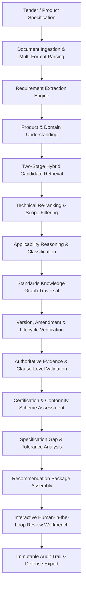
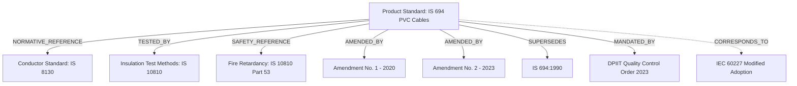
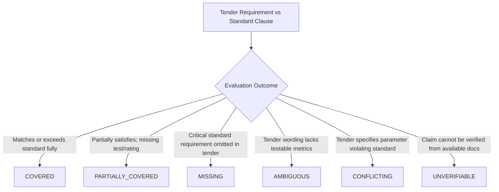
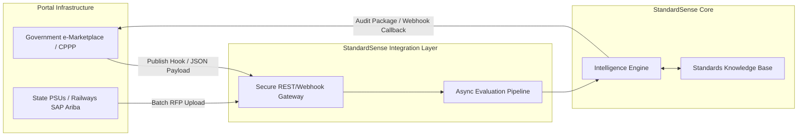

# StandardSense: Product Specification
## Evidence-First Procurement Standards Intelligence Engine

---

### Document Control
- **Product Name**: StandardSense
- **Document Version**: 1.0.0-PROPOSED
- **Status**: Foundational Specification
- **Initial Proving Ground**: SIH26108 — AI-Powered Recommendation Engine for Identifying Applicable Indian Standards for Procurement Specifications
- **Target Horizons**: Pan-India Public & Private Procurement (Phase 1) $\rightarrow$ Global Cross-Jurisdictional Intelligence (USA, UK, EU, ISO/IEC) (Phase 2+)
- **System Thesis**: *AI Finds $\rightarrow$ Rules Verify $\rightarrow$ Sources Prove $\rightarrow$ Human Approves*

---

## 1. Executive Summary & Product Overview

### 1.1 The Vision
StandardSense is an enterprise-grade, evidence-first technical standards intelligence platform. It ingests complex, unstructured, or semi-structured procurement documentation—such as Requests for Proposal (RFPs), Tenders, Bills of Materials (BOMs), and technical specification schedules—and reliably maps them to applicable national and international technical standards, regulatory mandates, conformity assessment schemes, and normative reference graphs.

StandardSense is not a conversational chatbot, a document question-answering toy, or a wrapper around a vector database. It is a deterministic, auditable engineering intelligence system designed to eliminate standards mismatch, obsolete standard citations, unverified compliance claims, and procurement litigation.

### 1.2 The Core Product Thesis
The fundamental operating principle governing every interaction within StandardSense is:

$$\mathbf{AI\ Finds} \longrightarrow \mathbf{Rules\ Verify} \longrightarrow \mathbf{Sources\ Prove} \longrightarrow \mathbf{Human\ Approves}$$

- **AI Finds**: Multi-modal language and embedding models parse messy technical requirements, resolve domain vernacular, extract continuous engineering constraints, and generate high-recall candidate standards.
- **Rules Verify**: Deterministic validation engines evaluate scope containment, parameter tolerances, voltage/pressure/grade boundaries, and version lifecycle states against structured facts.
- **Sources Prove**: The system surfaces authoritative, clause-level citations, gazette notifications, and verified standard excerpts. No recommendation is presented without immutable provenance.
- **Human Approves**: The platform provides interactive, explainable, and auditable verification interfaces for procurement officers and technical evaluation committees to make defensible, legally robust determinations.

---

## 2. Problem Statement & Industrial Context

### 2.1 The Macro Procurement Crisis
Technical procurement across government agencies, defense bodies, public sector undertakings (PSUs), and engineering, procurement, and construction (EPC) conglomerates involves thousands of technical specifications annually. In India alone, platforms such as the Government e-Marketplace (GeM) and the Central Public Procurement Portal (CPPP) process procurement volumes exceeding billions of dollars.

Within these tenders, technical specifications determine the safety, interoperability, performance, and legal validity of delivered goods and services. However, the mechanism for specifying technical standards is fundamentally broken:

1. **Stale and Withdrawn Citations**: Indenting officers frequently copy-paste technical specifications from legacy tender documents created 5 to 15 years prior. Consequently, tenders mandate standards that have been withdrawn, superseded, or fundamentally altered by recent amendments.
2. **Ambiguous and Conflicting Requirements**: Tender schedules regularly list arbitrary physical tolerances alongside conflicting national standards, creating commercial ambiguity and tender disputes.
3. **Ignorance of Mandatory Quality Control Orders (QCOs)**: Central government ministries (e.g., Ministry of Steel, DPIIT, MeitY) regularly issue statutory Quality Control Orders making BIS certification (ISI mark or CRS) legally mandatory for specific Harmonized System (HS) codes. Indenting officers often fail to include mandatory QCO clauses, exposing procurement entities to regulatory penalties or non-compliant deliveries.
4. **Neglect of Normative Hierarchies**: Standards do not exist in isolation. A product standard (e.g., IS 694 for PVC insulated cables) normatively depends on dozens of ancillary standards governing copper conductors (IS 8130), insulation test methods (IS 10810), and fire retardancy ratings. Tenders that fail to enforce the normative tree permit vendors to cut corners on sub-components.
5. **Lack of Automated Auditability**: When technical bids are evaluated, officers must manually verify vendor compliance claims against hundreds of pages of standards text. This manual review is error-prone, subjective, and difficult to defend during audit inspections by oversight agencies (such as the Comptroller and Auditor General [CAG] or Central Vigilance Commission [CVC]).

### 2.2 Global Problem Generalization
While SIH26108 specifies Indian Standards (Bureau of Indian Standards - BIS), this structural vulnerability exists globally:
- In the **United States**, Federal Acquisition Regulation (FAR) mandates and agency-specific requirements must cross-reference standards Incorporated by Reference (IBR) across ANSI, ASTM, ASME, and IEEE.
- In the **United Kingdom**, procurement specifications must align with British Standards (BSI) and UK Conformity Assessed (UKCA) requirements post-Brexit.
- In the **European Union**, the New Approach directives and harmonised standards (EN standards published in the Official Journal) determine CE marking conformity.
- In **International Trade**, public and private tenders balance ISO and IEC standards against domestic deviations and regional harmonization.

StandardSense solves this core structural challenge through an engine where **Jurisdiction is Data**, not hardcoded logic.

---

## 3. The Problem in Simple Language
When a government department or an infrastructure firm buys 10,000 street lights, 50 kilometers of railway cable, or 500 surgical ventilators, the tender document must specify exactly how strong, safe, fire-resistant, and efficient those products must be.

Today, the engineers writing these tenders and the officers reviewing vendor bids face three major hurdles:
1. They search outdated websites or search engines to find which Indian Standard applies.
2. They often cite standards that were cancelled years ago or miss mandatory government safety orders.
3. When vendors submit test certificates, nobody has the time to check whether the test method in the certificate actually matches the latest revision of the standard.

StandardSense acts as a rigorous technical co-pilot. An officer uploads a 60-page tender specification. Within seconds, StandardSense reads the engineering parameters, identifies the exact current standards that govern that equipment, checks if the government has made certification mandatory by law, points to the exact paragraphs that prove why each standard applies, and highlights any parameters the officer forgot to specify. The officer remains in full command, backed by an audit-ready, legally defensible evidence trail.

---

## 4. Target Users & User Personas

### 4.1 Target User Ecosystem
| User Category | Organization Types | Primary Focus |
| :--- | :--- | :--- |
| **Indenting Officers / Tender Drafters** | Ministries, Municipal Corporations, Defense, PSUs, EPCs | Generating legally airtight, current, and unambiguous technical specifications. |
| **Technical Evaluation Committees (TECs)** | Public Procurement Authorities, Railways, Power Grid, Port Trusts | Evaluating vendor bid compliance against mandated standards and test methods. |
| **Compliance & Quality Assurance Officers** | Third-party inspection agencies (e.g., RITES, SGS, DNV), QA wings | Verifying test certificates, inspection plans, and conformity declarations against active amendments. |
| **Procurement Portal Administrators** | GeM, CPPP, State Procurement Portals | Automating catalog standardization, attribute validation, and category mapping. |
| **Vendor Bidding & Compliance Teams** | Equipment Manufacturers, Industrial Suppliers, Contractors | Analyzing tender requirements to identify mandatory certifications and test gaps prior to bidding. |

### 4.2 User Personas

```
+---------------------------------------------------------------------------------------+
| PERSONA 1: Suman - Senior Indenting Officer (Public Sector Undertaking - Power)        |
| Background: Mechanical Engineer with 18 years in public power transmission projects.  |
| Goal: Draft a 400kV transformer tender with zero obsolete standards and full QCO.     |
| Pain Point: Spends 3 weeks manually cross-referencing BIS gazette notifications and   |
| legacy tenders; terrified of vigilance audit queries regarding outdated references.   |
| StandardSense Value: Uploads draft specs; receives instant analysis of active IS/IEC  |
| standards, mandatory QCO flags, and missing normative safety clauses.                 |
+---------------------------------------------------------------------------------------+
```

```
+---------------------------------------------------------------------------------------+
| PERSONA 2: Vikram - Member Secretary, Technical Evaluation Committee (Transport Infra)|
| Background: Rail Systems Specialist evaluating 14 multinational EPC bids.             |
| Goal: Determine whether the standards proposed by bidders are technically equivalent  |
| to mandated Indian Standards (RDSO / BIS) without subjective bias.                   |
| Pain Point: Bidders cite foreign standards (DIN, ASTM, EN) claiming equivalence, but  |
| verifying clause-by-clause parity takes months of engineering review.                 |
| StandardSense Value: Automated gap analysis showing covered, partially covered, and   |
| conflicting technical parameters between cited international and domestic standards.  |
+---------------------------------------------------------------------------------------+
```

```
+---------------------------------------------------------------------------------------+
| PERSONA 3: Ananya - Head of Bids & Regulatory Compliance (Cables & Switchgear OEM)    |
| Background: Electrical engineer specialized in conformity assessment and export regs.  |
| Goal: Rapidly pre-screen tender opportunities to verify whether OEM certifications    |
| cover every mandated clause, test method, and amendment.                             |
| Pain Point: Misses fine-print amendments published within the last 6 months, leading   |
| to disqualification at technical bid opening.                                         |
| StandardSense Value: Immediate diff of OEM test certificates against tender-mandated  |
| standards editions and latest published amendments.                                   |
+---------------------------------------------------------------------------------------+
```

---

## 5. Primary Use Cases

### UC-1: Intelligent Tender Specification Drafting & Pre-Publish Audit
- **Actor**: Indenting Officer.
- **Workflow**: The user uploads draft technical specifications or BOM items. StandardSense parses the functional requirements, identifies applicable standards, verifies their currentness, injects the correct edition and amendment citations, flags mandatory QCO/licensing requirements, and identifies missing parameters (e.g., "Flame retardant rating specified, but oxygen index test standard omitted").
- **Outcome**: An audit-ready, standardized technical schedule with zero stale citations.

### UC-2: Bid Technical Evaluation & Parity Analysis
- **Actor**: Technical Evaluation Committee Member.
- **Workflow**: The user submits the tender specification alongside one or more bidder technical submissions or product datasheets. The engine maps bidder compliance claims against tender requirements and underlying standards, highlighting deviations, unsupported claims, and unaccredited test reports.
- **Outcome**: A structured, clause-by-clause evaluation matrix with automated parity verification.

### UC-3: Foreign Standard Equivalence & Harmonization Screening
- **Actor**: Global Procurement Specialist / Defense Indenting Officer.
- **Workflow**: When an international bidder quotes compliance with ASTM, EN, or ISO standards instead of mandated Indian Standards (IS), the system traverses the standards knowledge graph to evaluate bilateral adoption, dual-numbering (e.g., IS/ISO equivalents), or parameter-level scope divergence.
- **Outcome**: A strictly verified equivalence assessment distinguishing formal statutory adoptions from subjective engineering approximations.

### UC-4: Dynamic Regulatory & QCO Compliance Monitoring
- **Actor**: Procurement Portal Category Manager / Enterprise Risk Officer.
- **Workflow**: Batch scanning of product category catalogs against newly notified Quality Control Orders, BIS gazette amendments, and Bureau enforcement circulars.
- **Outcome**: Real-time identification of catalog items or active procurement notices that violate newly enacted statutory standards.

---

## 6. End-to-End Product Workflow

StandardSense executes a strictly orchestrated 15-stage pipeline:



### Detailed Stage Breakdown
1. **Document Ingestion & Multi-Format Parsing**: Ingests PDFs, Word documents, text files, and scanned tenders; runs OCR and layout analysis to preserve tables, key-value parameter schedules, and hierarchical section numbers.
2. **Requirement Extraction**: Dissects unstructured paragraphs into atomic, testable technical requirements with standardized engineering units, physical properties, operational bounds, and environmental tolerances.
3. **Product & Domain Understanding**: Categorizes items into standardized taxonomies (e.g., NIC, CPV, UNSPSC) and resolves domain vernacular, colloquial product nicknames, and industry abbreviations.
4. **Hybrid Candidate Retrieval**: Employs dense vector embeddings, sparse lexical search (BM25), and structured metadata filtering to pull high-recall candidate standards from the knowledge base.
5. **Technical Re-ranking**: Cross-analyzes candidate standard scopes against extracted parameter boundaries (voltage classes, pipe diameters, tensile strengths) to eliminate superficial lexical matches.
6. **Applicability Reasoning**: Evaluates whether a standard applies directly to the complete product, conditionally to a sub-assembly, or specifically as an auxiliary test method.
7. **Standards Knowledge Graph Traversal**: Recursively traverses normative references, safety links, terminology standards, and component requirements to build the complete standard dependency tree.
8. **Version & Lifecycle Verification**: Inspects authoritative metadata to check whether each candidate standard is Current, Amended, Superseded, or Withdrawn, locking the active revision number and year.
9. **Evidence Validation**: Matches extracted requirements against exact standard clauses and tables, generating cryptographic or locator-based evidence anchors.
10. **Certification & Conformity Assessment**: Cross-references Ministry gazette orders and standards body registries to flag mandatory certification marks (e.g., ISI mark Scheme-I, CRS Scheme-II, CE, UL).
11. **Specification Gap Analysis**: Performs three-way reconciliation (Tender Requirement $\leftrightarrow$ Standard Requirement $\leftrightarrow$ Available Evidence) to flag omissions, over-specifications, or parameter conflicts.
12. **Recommendation Package Assembly**: Synthesizes the structured payload with explicit epistemic tagging (VERIFIED vs INFERRED) across all attributes.
13. **Human Review Workbench**: Renders the recommendation package in an intuitive interface allowing procurement engineers to inspect citations, compare clause texts, and record approval/rejection decisions.
14. **Audit Trail & Defense Export**: Generates cryptographically signed, timestamped audit dossiers ready for submission to regulatory, financial, and oversight bodies.

---

## 7. Input Types & Requirement Extraction

### 7.1 Permissible Input Types
StandardSense processes a diverse spectrum of procurement inputs:
- **Tender Documents**: Full-length RFP documents (PDF, DOCX) spanning 10 to 500+ pages containing commercial clauses, technical specifications, and general conditions of contract.
- **Technical Schedules & BOMs**: Structured spreadsheets or embedded document tables specifying item names, ratings, quantities, materials, and dimensional tolerances.
- **Free-Text Engineering Summaries**: Brief descriptions entered directly by procurement officers into portal text areas (e.g., *"Submersible pumpset for agricultural water extraction, 5HP, 3-phase, 415V, 50Hz, with copper winding and energy efficiency rating"*).
- **Direct Portal Feeds**: JSON/XML payloads delivered via API webhooks from platforms such as GeM, CPPP, or enterprise SAP/Ariba systems.
- **Scanned Legacy Tenders**: Rasterized PDF scans requiring high-fidelity OCR with table detection and noisy artifact suppression.

### 7.2 Requirement Extraction Architecture
The system converts unstructured text into atomic, machine-verifiable requirements using structured JSON schemas.

```json
{
  "requirement_id": "REQ-ELEC-0412",
  "source_section": "Section 4.3.2 - Armoured Power Cables",
  "verbatim_text": "Cables shall be 1.1 kV grade, heavy-duty, XLPE insulated, galvanised steel wire armoured with extruded PVC outer sheath complying with flame retardant low smoke characteristics.",
  "extracted_parameters": {
    "voltage_rating": {
      "nominal_value": 1100,
      "unit": "V",
      "normalized_category": "low_voltage"
    },
    "conductor_material": "copper_or_aluminum_unspecified",
    "insulation_type": "XLPE",
    "armouring_type": "galvanised_steel_wire",
    "outer_sheath": "PVC_FRLS"
  },
  "inferred_intent": "Product Specification - Low Voltage Industrial Power Distribution",
  "extraction_confidence": 0.96,
  "epistemic_status": "VERIFIED"
}
```

Key Extraction Guarantees:
- **Verbatim Retention**: The original source text is permanently linked to prevent semantic drift.
- **Unit Normalization**: Standardizes engineering units (e.g., $kV \rightarrow V$, $N/mm^2 \rightarrow MPa$, $HP \rightarrow kW$) while retaining original stated values.
- **Constraint Typing**: Distinguishes between hard constraints (*"shall not exceed 0.5%"*), soft preferences (*"preferably equipped with"*), and conditional clauses (*"if outdoor installation is required"*).

---

## 8. Epistemic Trust Model & Safety Philosophy

StandardSense enforces a strict trust model to ensure that probabilistic AI models never fabricate regulatory or engineering facts.

```
       +---------------------------------------------------------------+
       |             STANDARDSENSE EPISTEMIC TAXONOMY                  |
       +---------------------------------------------------------------+
       | 1. VERIFIED        : Backed by authoritative source evidence  |
       | 2. INFERRED        : Deduced by logic; no direct clause proof |
       | 3. UNKNOWN         : Insufficient evidence available          |
       | 4. CONFLICTING     : Authoritative sources directly disagree  |
       | 5. OUT_OF_COVERAGE : Outside indexed standards/jurisdiction   |
       +---------------------------------------------------------------+
```

### 8.1 Detailed Epistemic Status Definitions
1. **VERIFIED**: The assertion (standard ID, title, clause content, version currentness, or mandatory certification status) is backed by an immutable, authoritative source record (e.g., official BIS Gazette, published standard catalog, statutory QCO order).
2. **INFERRED**: The claim is derived via semantic model reasoning or heuristic correlation (e.g., predicting that an unstated test method is required based on related industry practice). INFERRED claims are visually differentiated and require explicit human sign-off.
3. **UNKNOWN**: The system recognizes the query or engineering parameter but cannot establish applicability due to incomplete specification data or absent standard clauses. The system outputs an explicit `UNKNOWN` state rather than guessing.
4. **CONFLICTING**: Two or more authoritative sources provide irreconcilable information (e.g., a tender demands compliance with an amended standard clause while specifying physical parameters that violate the amendment).
5. **OUT_OF_COVERAGE**: The requested domain, jurisdiction, or private standard (e.g., proprietary corporate specifications, military classified standards) falls outside the active indexed corpus.

### 8.2 Strict Operational Guardrails
- **Zero Hallucinated Standard IDs**: Standard identifiers must pass a hard foreign-key validation check against the authoritative standards master catalog before presentation to any user. If an LLM suggests an unverified identifier, it is caught by validation rules and rejected.
- **Decoupled Verification**: Language models propose candidate mappings; deterministic rule engines verify version lifecycle, parameter boundaries, and statutory enforcement.

---

## 9. Standards Knowledge Graph & Normative Relationships

A technical standard is not a flat PDF; it is an active node within an interconnected technical, legal, and operational graph.



### 9.1 Modeled Relationship Types
| Relationship | Semantic Meaning | Propagation Rule |
| :--- | :--- | :--- |
| `NORMATIVE_REFERENCE` | Mandatory reference cited within the standard text without which the standard cannot be implemented. | Inherited directly into the procurement compliance checklist. |
| `TESTED_BY` | Specifies the exact physical, chemical, or electrical test procedure governing a performance requirement. | Flagged in technical bid evaluation as mandatory test method. |
| `SAFETY_REFERENCE` | Governs personal safety, hazardous substance restrictions, or emergency behavior. | Classified as non-negotiable critical failure item. |
| `TERMINOLOGY_REFERENCE` | Defines symbols, nomenclature, units, and engineering definitions. | Used by extraction engine to resolve tender ambiguity. |
| `INSTALLATION_REFERENCE` | Code of practice for field erection, commissioning, and maintenance. | Tagged for EPC/service contracts rather than equipment supply. |
| `AMENDED_BY` | Modifies specific clauses, tables, or limits of the base standard. | Overrides base standard clauses during gap analysis. |
| `SUPERSEDES` | Replaces an older standard edition. | Triggers deprecation warning if older standard is cited in tender. |
| `SUPERSEDED_BY` | Identifies the active replacement for a retired standard. | Automatically suggests replacement standard to indenting officer. |
| `EQUIVALENT_TO` | Authoritatively certified identical bilateral adoption (e.g., dual-numbered). | Requires explicit statutory confirmation; never inferred casually. |
| `CORRESPONDS_TO` | Substantive technical alignment with domestic modifications (e.g., modified ISO/IEC). | Identified with documented divergence notes. |
| `APPLIES_TO` | Product category, HS code, or engineering domain governed by the standard. | Core retrieval edge connecting products to standards. |

---

## 10. Version & Amendment Intelligence

Citing an unversioned or obsolete standard in public procurement invites delivery of sub-standard goods or immediate legal disqualification of tenders.

### 10.1 Version Lifecycle States
Every standard in StandardSense exists in exactly one authoritative lifecycle state:

```
[ DRAFT / UNDER REVIEW ]
         |
         v
    [ CURRENT ] <-------------\
     |        |                |
     |        | (Amendment)    | (Reaffirmation)
     |        v                |
     |   [ AMENDED ] ----------/
     |
     v (Revision / New Standard)
[ SUPERSEDED ]
     |
     v (Formal Withdrawal)
[ WITHDRAWN / OBSOLETE ]
```

- **CURRENT**: Fully active, published standard edition; no unintegrated amendments pending.
- **AMENDED**: Active standard subject to one or more published amendments modifying specific clauses.
- **SUPERSEDED**: Formally replaced by a newer revision or consolidated standard; retained in system for auditability of historical tenders.
- **WITHDRAWN / OBSOLETE**: Formally cancelled by the standards body without direct replacement.
- **UNKNOWN / UNVERIFIED**: Metadata verification pending against national gazette; triggers human review gate.

### 10.2 Amendment Application Rules
When StandardSense evaluates a requirement against an `AMENDED` standard:
1. It maintains the base standard text as immutable historical foundation.
2. It compiles active amendments sequentially by effective date.
3. If an amendment alters a parameter (e.g., maximum permissible lead content reduced from 0.05% to 0.01%), the gap analysis engine evaluates vendor compliance strictly against the amended threshold.
4. The system reports the exact amendment number and publication date alongside the base standard citation.

---

## 11. Regulatory & Conformity Assessment Intelligence

### 11.1 The Statutory Compliance Imperative
In jurisdictions like India, technical standards operate on two distinct planes:
1. **Voluntary Technical Standards**: Consensus guidelines adopted by market participants for commercial quality.
2. **Statutory Quality Control Orders (QCOs)**: Mandatory orders issued by central ministries under the Bureau of Indian Standards Act, 2016. Selling, manufacturing, importing, or procuring goods covered by a notified QCO without an active BIS Standard Mark (ISI mark or CRS registration) is a criminal offense.

### 11.2 Conformity Regimes Modeled
StandardSense categorizes conformity requirements into discrete regimes:

| Conformity Scheme | Governing Mechanism | Enforcement Scope | Mandatory Evidence Required |
| :--- | :--- | :--- | :--- |
| **BIS Scheme-I (ISI Mark)** | Factory inspection, sample testing, continuous surveillance. | Industrial goods, safety equipment, steel, cables, cement. | Valid BIS License Number (CML), ISI mark on product/packaging. |
| **BIS Scheme-II (CRS)** | Self-declaration of conformity based on laboratory test reports. | Electronics, IT goods, solar inverters, LED drivers. | BIS Registration Number (R-number) on product and portal. |
| **Type Test Certification** | Independent testing by accredited lab (e.g., NABL, CPRI). | High-voltage switchgear, rail locomotives, defense components. | Certified type test reports within validity window (e.g., 5 yrs). |
| **Routine / Acceptance Tests**| Batch-wise factory acceptance testing prior to dispatch. | Pipe consignments, structural steel, transformer oils. | Joint inspection certificate, Manufacturer's Test Certificate (MTC). |

---

## 12. Specification Gap Analysis Engine

The Specification Gap Analysis engine performs a three-way reconciliation:

$$\mathbf{Tender\ Specification\ Requirement} \iff \mathbf{Standard\ Clause\ Requirement} \iff \mathbf{Authoritative\ Evidence}$$

### 12.1 Gap Classification Taxonomy
Every requirement evaluated by the system receives one of six mutually exclusive gap classifications:



1. **COVERED**: The tender requirement completely matches or exceeds the technical performance threshold of the applicable standard clause.
2. **PARTIALLY_COVERED**: The tender addresses the physical attribute but omits critical sub-parameters (e.g., specifies tensile strength but omits elongation percentage at break).
3. **MISSING**: The applicable standard mandates a critical safety or performance requirement (e.g., insulation resistance test under wet conditions) that is completely absent from the tender specification.
4. **AMBIGUOUS**: The tender requirement uses subjective language (*"shall be of best commercial quality"*, *"adequate thickness"*) that cannot be objectively verified against standard tolerances.
5. **CONFLICTING**: The tender specification directly contradicts the applicable standard (e.g., specifies copper conductor for an equipment standard that strictly permits only aluminum alloy).
6. **UNVERIFIABLE**: The submission references an unindexed test standard, a proprietary manufacturer test code, or lacks supporting test certificates.

*Important Boundary Notice*: StandardSense provides technical gap analysis as an engineering and procurement decision-support aid. It does not issue legal certifications of compliance.

---

## 13. The Recommendation Package

StandardSense outputs a comprehensive, structured **Recommendation Package**. An illustrative conceptual payload is presented below:

```json
{
  "recommendation_id": "REC-2026-IND-88419",
  "tender_id": "TND-PWR-2026-092",
  "generated_at": "2026-09-08T18:15:30Z",
  "status": "REQUIRES_HUMAN_REVIEW",
  "overall_confidence": 0.94,
  "standards": [
    {
      "standard_id": "IS 694",
      "full_title": "Polyvinyl Chloride Insulated Unsheathed and Sheathed Cables/Cords with Rigid and Flexible Conductor for Rated Voltages up to and Including 450/750 V",
      "jurisdiction": "IND",
      "standards_body": "BIS",
      "edition": "Fifth Revision (2010)",
      "currentness_status": "AMENDED",
      "active_amendments": [
        {
          "amendment_number": 1,
          "year": 2014,
          "summary": "Incorporation of fire survival cable requirements"
        },
        {
          "amendment_number": 2,
          "year": 2020,
          "summary": "Revision of conductor resistance values for flexible cords"
        }
      ],
      "applicability_status": "DIRECTLY_APPLICABLE",
      "applicability_explanation": "Directly governs the physical, electrical, and dimensional requirements for the 1.1kV PVC control cables specified in Section 3.2.",
      "epistemic_verification": {
        "standard_existence": "VERIFIED",
        "currentness": "VERIFIED",
        "clause_mapping": "VERIFIED",
        "applicability_rationale": "INFERRED"
      },
      "regulatory_status": {
        "mandatory_certification": true,
        "scheme": "BIS Scheme-I (ISI Mark)",
        "governing_order": "DPIIT Electrical Cables (Quality Control) Order, 2023",
        "effective_date": "2023-12-31",
        "regulatory_verification": "VERIFIED"
      },
      "matched_requirements": [
        {
          "tender_requirement_ref": "REQ-ELEC-0412",
          "standard_clause": "Clause 8.1 - Conductor",
          "status": "COVERED",
          "evidence": {
            "source_type": "BIS_OFFICIAL_STANDARD",
            "source_document_id": "DOC-BIS-IS694-2010-REV5",
            "page": 12,
            "table": "Table 1 - Conductor Material and Resistance",
            "excerpt": "The conductors shall consist of plain or tinned annealed high conductivity copper or aluminum conforming to IS 8130.",
            "verification_state": "VERIFIED"
          }
        }
      ],
      "specification_gaps": [
        {
          "gap_id": "GAP-01",
          "classification": "MISSING",
          "standard_clause": "Clause 14.3 - Flame Retardant Low Smoke Test",
          "description": "Tender mandates FRLS rating but omits mandatory test reference IS 10810 (Part 58) for critical oxygen index measurement.",
          "recommended_action": "Incorporate explicit reference to IS 10810 (Part 58) with minimum oxygen index of 29%."
        }
      ],
      "normative_references": [
        {
          "standard_id": "IS 8130",
          "title": "Conductors for Insulated Electric Cables and Flexible Cords",
          "currentness_status": "CURRENT",
          "relation_type": "NORMATIVE_REFERENCE"
        },
        {
          "standard_id": "IS 10810",
          "title": "Methods of Test for Cables",
          "currentness_status": "CURRENT",
          "relation_type": "TESTED_BY"
        }
      ]
    }
  ],
  "audit_fingerprint": {
    "engine_version": "v1.4.0-prod",
    "retrieval_snapshot_id": "SNAP-IND-BIS-2026-09-01",
    "model_id": "gemini-3.8-flash-enterprise",
    "sha256_hash": "e3b0c44298fc1c149afbf4c8996fb92427ae41e4649b934ca495991b7852b855"
  }
}
```

---

## 14. Human Review & Workflow Integration

StandardSense is designed as a human-in-the-loop decision-support instrument.

```
+----------------------------------------------------------------------------------------------------+
| STANDARDSENSE VERIFICATION WORKBENCH                                                               |
+----------------------------------------------------------------------------------------------------+
| Tender: TND-PWR-2026-092 | Item: 1.1kV XLPE Submersible Cable                                     |
+----------------------------------------------------------------------------------------------------+
| RECOMMENDED STANDARD: IS 694:2010 (Amended 2020) [VERIFIED]                                         |
| Status: Mandatory QCO Applied (DPIIT-2023) [VERIFIED]                                              |
+----------------------------------------------------------------------------------------------------+
| TENDER SPECIFICATION                    | MATCHED STANDARD CLAUSE (IS 694)                         |
| "Conductor shall be annealed bare copper| "Clause 8.1: Conductors shall comply with IS 8130.       |
| with conductivity > 99.5%."             | Resistance: Class 2 or Class 5 stranded copper."         |
| [Status: COVERED]                       | [Source: Page 12, Table 1 - PROVEN]                      |
+----------------------------------------------------------------------------------------------------+
| DETECTED GAPS (1 Critical)                                                                         |
| [!] MISSING: Oxygen Index Test standard (IS 10810 Part 58) omitted in tender.                     |
+----------------------------------------------------------------------------------------------------+
| HUMAN ACTION REQUIRED:                                                                             |
| [X] Accept Standard Recommendation     [ ] Override / Select Alternative Standard                  |
| [X] Adopt Recommended Gap Correction   [ ] Dismiss Gap Warning (Reason Required)                   |
| Officer Signature: __________________   Date: 2026-09-08                                           |
+----------------------------------------------------------------------------------------------------+
```

### 14.1 Review Policies & Audit Traceability
- **Non-Bypassable Review**: High-stakes procurement decisions (e.g., rejecting a bidder, issuing a tender notice) cannot proceed without an authenticated officer recording a review disposition.
- **Override Justification**: If an officer overrides a system recommendation (e.g., accepting a foreign equivalent or dismissing a QCO alert), the platform mandates entry of a structured technical rationale that is permanently logged to the audit record.

---

## 15. Multilingual Capabilities & Regional Procurement

Public procurement in federal democracies like India spans multiple administrative languages:
- Central portals (GeM, CPPP) operate predominantly in English and Hindi.
- State procurement boards (e.g., Tamil Nadu, Maharashtra, West Bengal, Gujarat) frequently publish tender notices, technical annexures, and specifications in regional official languages.

### 15.1 Architectural Multilingual Guarantees
1. **Preservation of Verbatim Input**: The original text in its native script (e.g., Devanagari, Bengali, Tamil) is stored immutably.
2. **Normalized Translation Layer**: Technical parameters and clauses are translated into a standardized English representation for cross-lingual vector retrieval and rule evaluation.
3. **Dual-Script Presentation**: The user interface renders side-by-side bilingual comparisons, presenting the original vernacular clause alongside the matched national standard in English.

---

## 16. Procurement Portal Integration Concept

StandardSense is architected for seamless integration into national procurement infrastructure:



### Integration Capabilities
- **Tender Creation Assistant (GeM Indenting)**: An interactive widget embedded into the GeM product upload wizard that auto-suggests applicable Indian Standards and validates parameter inputs in real time.
- **Automated Catalog Harmonization**: Background cron jobs that scan GeM product category descriptions, mapping dynamic vendor catalog listings to standardized BIS product codes.
- **Bid Opening Verifier**: Automated webhook trigger on tender bid closing that parses technical bid PDFs and populates the technical evaluation committee's comparative statement.

---

## 17. Trust, Safety & Failure Modes

### 17.1 Failure Scenario Matrix & Safe Degradation Policies

| Failure Scenario | Trigger Condition | System Behavior | Safeguard Policy |
| :--- | :--- | :--- | :--- |
| **No Relevant Standard Found** | Retrieval score below threshold across all candidate standards. | Return status `OUT_OF_COVERAGE` with clear explanation. | **Never guess.** Prompt user for additional domain context or suggest related international codes. |
| **Low-Confidence Candidate** | Semantic candidates match text superficially, but parameter bounds diverge. | Return candidate tagged as `INFERRED` with low confidence flag. | Mandate human review; highlight parameter divergence explicitly. |
| **Conflicting Authoritative Sources** | State gazette contradicts central QCO, or standards body publishes conflicting notices. | Return status `CONFLICTING`; display both source citations. | System refuses automated resolution; routes to senior legal/procurement officer. |
| **Stale / Obsolete Source Data** | Standards metadata cache exceeds time-to-live without successful sync. | Display `STALE_CACHE_WARNING` banner with cache timestamp. | Prevent automated sign-off on tenders until upstream catalog verification succeeds. |
| **OCR / Parser Degradation** | Rasterized scan has low OCR character confidence ($< 70\%$). | Halt automated extraction; highlight low-fidelity document regions. | Require user to review extracted text snippets before retrieval stage. |
| **Downstream LLM Service Outage** | External AI model API times out or throws rate-limit errors. | Fall back to deterministic lexical retrieval (BM25) and rule engine. | Notify user that semantic reasoning is degraded; provide lexical matches. |

---

## 18. Functional & Non-Functional Requirements

### 18.1 Functional Requirements (FRs)

```
+---------+-------------------------------------------------------------------------------------------+
| REQ ID  | REQUIREMENT DESCRIPTION                                                                   |
+---------+-------------------------------------------------------------------------------------------+
| FR-01   | Ingest multi-page technical documents in PDF, DOCX, TXT, and scanned image formats.       |
| FR-02   | Extract tabular parameter schedules and preserve column-row structural associations.      |
| FR-03   | Deconstruct engineering specifications into atomic, normalized technical requirements.     |
| FR-04   | Execute two-stage hybrid retrieval combining BM25, dense embeddings, and metadata filters.|
| FR-05   | Filter candidate standards against physical boundaries (voltage, pressure, temperature).  |
| FR-06   | Classify standard applicability (Directly Applicable, Sub-component, Auxiliary Test).     |
| FR-07   | Traverse the Standards Knowledge Graph to discover recursive normative references.        |
| FR-08   | Identify active version lifecycle state (Current, Amended, Superseded, Withdrawn).         |
| FR-09   | Flag mandatory statutory Quality Control Orders (QCOs) based on HS codes and keywords.     |
| FR-10   | Execute specification gap analysis classifying requirements into the 6-state taxonomy.    |
| FR-11   | Attach clause-level, page-referenced evidence anchors to all recommendations.              |
| FR-12   | Tag all output attributes with explicit epistemic status (VERIFIED vs INFERRED).           |
| FR-13   | Provide an interactive human-in-the-loop review workbench for technical approvals.        |
| FR-14   | Log all inputs, candidate sets, model prompts, and human actions to an immutable audit log.|
| FR-15   | Export audit-ready compliance dossiers in PDF and cryptographically signed JSON formats.   |
| FR-16   | Process multilingual input documents in Hindi and major regional languages via normalization|
+---------+-------------------------------------------------------------------------------------------+
```

### 18.2 Non-Functional Requirements (NFRs)

```
+---------+--------------------+----------------------------------------------------------------------+
| NFR ID  | DIMENSION          | TARGET CRITERION                                                     |
+---------+--------------------+----------------------------------------------------------------------+
| NFR-01  | Retrieval Latency  | End-to-end candidate retrieval $\le$ 3.0 seconds for 50-page tender.|
| NFR-02  | Extraction Recall  | Extract $\ge$ 95% of explicit numerical parameter tolerances.        |
| NFR-03  | Hallucination Rate | 0.0% unverified or fabricated standard identifiers in recommendations|
| NFR-04  | Audit Immutability | 100% of generated recommendations reproducible via audit snapshot ID |
| NFR-05  | Document Security  | AES-256 encryption at rest; TLS 1.3 in transit; tenant data isolation|
| NFR-06  | System Availability| 99.9% uptime for core API and retrieval services                     |
| NFR-07  | Concurrency        | Support 50 concurrent tender analysis jobs without degradation        |
+---------+--------------------+----------------------------------------------------------------------+
```

---

## 19. MVP Scope vs Explicit Non-Goals

### 19.1 MVP Scope Discipline (Phase 1)
To ensure immediate production impact and defensibility, Phase 1 focuses rigorously on high-frequency, high-scrutiny procurement domains in India:

```
+---------------------------------------------------------------------------------------+
| IN SCOPE (PHASE 1 - MVP):                                                             |
| 1. High-Impact BIS Standard Domains:                                                  |
|    - Electrical Goods & Power Distribution (Cables, Switchgear, Transformers, Motors) |
|    - Construction Materials (Steel, Cement, Structural Elements, PVC Pipes)          |
|    - Personal Protective Equipment & Safety Gear (Helmets, Safety Shoes, Respiratory) |
| 2. Complete Integration of Indian Standards (BIS) catalog metadata & active QCOs.     |
| 3. High-precision two-stage retrieval (BM25 + pgvector + domain re-ranker).          |
| 4. 15-stage core pipeline from document upload to audit dossier generation.           |
| 5. Human-in-the-loop review workbench with interactive clause verification.          |
+---------------------------------------------------------------------------------------+
```

### 19.2 Explicit Non-Goals
To prevent feature creep and loss of technical focus, the following items are strictly out of scope for the MVP:

```
+---------------------------------------------------------------------------------------+
| EXPLICIT NON-GOALS (DO NOT BUILD IN MVP):                                             |
| [X] Generic Conversational Chatbot: No free-form chit-chat or generic Q&A.            |
| [X] Automated Legal Certification: System does not issue legal compliance certificates|
| [X] Automatic Bid Disqualification: System never automatically disqualifies a bidder; |
|     it provides evidence for human committee determination.                           |
| [X] Direct Vendor Bidding Automation: Not an automated bidding bot for contractors.  |
| [X] Real-Time Multi-Jurisdiction Engine for 50+ Countries: MVP is architected for     |
|     global expansion, but data population in MVP is restricted to India (BIS).       |
| [X] Full-Text Copyright Redistribution: The system never distributes proprietary      |
|     copyrighted standard PDFs; it indexes metadata and permitted technical excerpts.  |
+---------------------------------------------------------------------------------------+
```

---

## 20. Future & Global Expansion Roadmap

StandardSense is architected from day zero so that **Jurisdiction is Data**.

```
+-----------------------------------------------------------------------------------------+
| PHASE 1: India Proving Ground (SIH26108)                                                |
| Focus: BIS (IS standards), GeM/CPPP tenders, Central QCOs (DPIIT, Steel, MeitY).       |
+-----------------------------------------------------------------------------------------+
                                           |
                                           v
+-----------------------------------------------------------------------------------------+
| PHASE 2: Bilateral Trade & Harmonization (India + ISO/IEC)                             |
| Focus: Dual-numbered standards (IS/ISO, IS/IEC), foreign equivalence verification,     |
| Defense procurement (DGQA / RDSO specifications).                                      |
+-----------------------------------------------------------------------------------------+
                                           |
                                           v
+-----------------------------------------------------------------------------------------+
| PHASE 3: Global Public & Defense Procurement (US, UK, EU)                              |
| Focus: US FAR / DoD / ANSI / ASTM / NIST; UK BSI / UKCA; EU Harmonised Standards / CE.  |
+-----------------------------------------------------------------------------------------+
```

### Global Data Model Generalization
The core domain model treats standards bodies as polymorphic entities:
- In the US, the engine parses NIST and ASTM references under federal acquisition rules.
- In the EU, the engine links Machinery and Low Voltage Directives to Harmonised EN standards published in the Official Journal.
- The underlying extraction, graph traversal, gap analysis, and evidence-linking algorithms remain 100% identical.

---

## 21. Success Criteria & Evaluation Philosophy

### 21.1 Evaluation Framework
Evaluation in StandardSense is treated as a rigorous, continuous engineering discipline rather than subjective spot-checking.

```
+------------------------------------+--------------------------+-----------------------+
| EVALUATION METRIC                  | BASELINE (MANUAL / RAG)  | STANDARDSENSE TARGET  |
+------------------------------------+--------------------------+-----------------------+
| Retrieval Recall@10 (Standards)    | 62.0% (Vanilla RAG)      | $\ge$ 92.0% (PLANNED) |
| Normative Reference Recall         | 18.0% (Manual Search)    | $\ge$ 88.0% (PLANNED) |
| Obsolete Standard Flagging Rate    | 34.0% (Manual Review)    | 100.0% (TARGET)       |
| Mandatory QCO Detection Rate       | 41.0% (Indenting Officers)| 100.0% (TARGET)       |
| Unsupported Standard ID Rate       | 14.0% (Generic LLM)      | 0.0% (MANDATED)       |
| Time-to-Audit (50-page RFP)        | 4.5 Days (Manual Review) | $\le$ 15 Min (TARGET) |
| Human Committee Acceptance Rate    | N/A                      | $\ge$ 85.0% (TARGET)  |
+------------------------------------+--------------------------+-----------------------+
```

*Status Definitions*:
- **MANDATED**: Hard engineering gate enforced by code; violation prevents release.
- **TARGET**: Primary operational performance goal for Phase 1 deployment.
- **PLANNED**: Benchmark target to be measured against a curated ground-truth test suite of 200 real-world public tenders.
- **MEASURED**: Will reflect verified empirical data once bench evaluation commences.

---

## 22. Foundational Domain Concepts & Entity Taxonomy

To ensure conceptual coherence across product and engineering teams, the following entity definitions are standardized:

```
+----------------------------+-----------------------------------------------------------------------------------------+
| DOMAIN ENTITY              | OPERATIONAL DEFINITION                                                                  |
+----------------------------+-----------------------------------------------------------------------------------------+
| Jurisdiction               | The legal and geographical territory governing procurement (e.g., India, EU, US).      |
| StandardsBody              | The national or international body issuing standards (e.g., BIS, ISO, IEC, ASTM).       |
| RegulatoryBody             | The statutory authority mandating compliance (e.g., DPIIT, Ministry of Power, OSHA).    |
| Standard                   | An authoritative technical document defining requirements, specifications, or methods.  |
| Edition                    | A distinct, major versioned release of a standard (e.g., "Third Revision: 2018").       |
| Amendment                  | An official revision modifying specific clauses or tables of an active Edition.         |
| Supersession               | The formal legal act replacing an older standard or edition with a new release.         |
| Scope                      | The technical, physical, and functional boundaries within which a standard applies.     |
| Clause                     | An individual numbered section of a standard containing specific engineering mandates.   |
| Requirement                | An atomic, testable performance threshold, dimension, or property extracted from text.  |
| NormativeReference         | An indispensable reference cited within a standard required to satisfy compliance.     |
| RelatedStandard            | An informative or complementary standard providing guidance but not strictly mandatory. |
| TestMethod                 | A standardized physical, chemical, or operational procedure to measure a parameter.     |
| SafetyReference            | A normative standard specifically addressing life-safety, fire, or toxic hazards.       |
| TerminologyReference       | A standard defining engineering terms, symbols, and mathematical notations.             |
| InstallationReference      | A standard detailing field erection, commissioning, and maintenance practices.          |
| CertificationRequirement   | A statutory mandate requiring third-party testing, licensing, or marking (e.g., ISI).   |
| ConformityRequirement      | The specific conformity assessment scheme (e.g., Scheme-I factory audit, Scheme-II CRS).|
| Evidence                   | An immutable, locatable anchor linking a claim to an authoritative source record.       |
| Source                     | The originating authoritative document (e.g., Gazette notification, published standard).|
| Recommendation             | A structured, evidence-backed package proposing standards and gaps for human review.    |
| AuditRecord                | An immutable snapshot of all inputs, outputs, rules, and human decisions for a tender.  |
+----------------------------+-----------------------------------------------------------------------------------------+
```

---

## 23. Real-World Case Study: Obsolete Pipe Specification Failure & Recovery

To illustrate the concrete value of StandardSense, consider a real-world scenario frequently encountered in municipal water supply tenders:

```
+----------------------------------------------------------------------------------------------------+
| SCENARIO: 800mm Mild Steel Water Supply Pipeline Tender                                             |
+----------------------------------------------------------------------------------------------------+
| Tender Specification Snippet:                                                                      |
| "Supply and laying of 800mm nominal bore Mild Steel pipes, ERW type, complying with IS 1239.       |
| Minimum wall thickness 8.0mm. Pipes shall be cement mortar lined."                                |
+----------------------------------------------------------------------------------------------------+
| SYSTEM INTELLIGENCE EXECUTION:                                                                     |
| 1. Parameter Extraction:                                                                           |
|    - Product: Mild Steel Pipe, ERW                                                                 |
|    - Diameter: 800 mm Nominal Bore                                                                 |
|    - Wall Thickness: 8.0 mm                                                                        |
|    - Lining: Cement Mortar                                                                         |
|    - Tender-Cited Standard: IS 1239                                                                |
|                                                                                                    |
| 2. Scope & Boundary Verification (Rules Engine):                                                  |
|    - Scope Query: IS 1239 (Part 1) governs steel tubes up to 150 mm nominal bore ONLY.             |
|    - Conflict Detected: 800mm is OUT-OF-BOUNDS for IS 1239. Citing IS 1239 for 800mm is a fatal    |
|      engineering error that would invalidate the procurement or lead to delivery of unsafe pipes.  |
|                                                                                                    |
| 3. Candidate Retrieval & Re-ranking:                                                               |
|    - System retrieves IS 3589: "Steel Pipes for Water and Sewage (168.3 to 2540 mm Outside Dia)".  |
|    - Currentness Check: IS 3589:2001 (Reaffirmed 2020) [VERIFIED - CURRENT].                      |
|                                                                                                    |
| 4. Regulatory & QCO Check:                                                                         |
|    - Ministry of Steel QCO mandates mandatory BIS licensing (Scheme-I) for IS 3589 pipes.          |
|                                                                                                    |
| 5. Recommendation Package Output:                                                                  |
|    - Status: CRITICAL CONFLICT IDENTIFIED                                                          |
|    - Alert: "Tender cites IS 1239, but diameter 800mm exceeds IS 1239 maximum limit (150mm)."      |
|    - Proposed Correction: Mandate IS 3589 Grade Fe 410 with mandatory ISI mark per Steel QCO.     |
|    - Missing Normative Reference: IS 1918 for hydraulic testing; IS 11906 for cement mortar lining.|
|                                                                                                    |
| 6. Audit Trail:                                                                                    |
|    - Officer accepts correction; replacement logged with citation to IS 3589 Scope Clause 1.1.    |
+----------------------------------------------------------------------------------------------------+
```

This automated intervention protects public procurement entities from multimillion-dollar litigation, contractor claims, and catastrophic pipeline failures.

---

## 24. Official References & Authoritative Regulatory Framework

To ensure that requirement extraction, standards recommendation, and conformity checks remain anchored in official domain realities rather than speculative models, StandardSense aligns with the statutory and administrative sources governing the Indian Standards ecosystem.

### 24.1 Alignment with the Product Intelligence Workflow
Official references support the user journey at each distinct transition:

$$\mathbf{User / Tender} \longrightarrow \mathbf{Requirement\ Understanding} \longrightarrow \mathbf{Applicable\ Standards} \longrightarrow \mathbf{Certification / Conformity} \longrightarrow \mathbf{Evidence-Backed\ Recommendation}$$

```
+---------------------------------------------------------------------------------------------------------+
| WORKFLOW STAGE                     | PRIMARY OFFICIAL ANCHOR & REGULATORY RELEVANCE                     |
+---------------------------------------------------------------------------------------------------------+
| Standards Discovery                | BIS Standards Portal: Identifies official standard existence,     |
|                                    | titles, and divisional scope boundaries.                           |
| Metadata & Lifecycle Verification  | BIS Know Your Standard: Verifies active edition, published         |
|                                    | amendments, reaffirmed status, and technical committee jurisdiction.|
| Statutory Foundation               | BIS Act, 2016 (India Code): Provides legal authority for national  |
|                                    | standards, standard marks, and penal provisions for non-compliance.|
| Conformity Scheme Intelligence     | BIS Product Certification: Identifies applicable conformity regimes|
|                                    | (e.g., Scheme-I ISI Mark, Scheme-II Compulsory Registration).       |
| Mandatory Enforcement Audits       | Products Under Compulsory Certification: Identifies items governed |
|                                    | by statutory Quality Control Orders (QCOs) where marking is law.   |
| Verification Checklist Formation   | BIS Certification Process: Models testing schemes, factory audit  |
|                                    | requirements, and surveillance protocols for technical evaluation.  |
+---------------------------------------------------------------------------------------------------------+
```

### 24.2 Curated Official Sources (India / BIS Proving Ground)
The following official Government of India and Bureau of Indian Standards resources represent the initial authoritative ecosystem:

- [BIS Standards Portal](https://standards.bis.gov.in/) — Official BIS standards discovery and information portal, providing the authoritative registry of published Indian Standards, division-wise technical catalogs, and draft standards under public review.
- [BIS — Know Your Standard](https://www.bis.gov.in/know-your-standard/) — Official BIS resource for discovering standards and related information such as active amendments, gazette notifications, testing schemes, recognized laboratories, active licenses, and sectional committees.
- [BIS Act, 2016 (India Code)](https://www.indiacode.nic.in/bitstream/123456789/2157/3/A2016-11.pdf) — Government of India legal source defining the statutory framework for the national standards body, the establishment of Indian Standards, the legal effect of the Standard Mark, and the statutory basis for mandatory Quality Control Orders (QCOs).
- [BIS Product Certification](https://www.bis.gov.in/product-certification/) — Official information portal on BIS product certification schemes, operating guidelines, conformity assessment frameworks, and factory surveillance requirements.
- [BIS — Products Under Compulsory Certification](https://www.bis.gov.in/product-certification/products-under-compulsory-certification/) — Official BIS registry detailing product categories, HS codes, and Indian Standards covered under mandatory certification regimes notified by Central Government ministries.
- [BIS Certification Process](https://www.bis.gov.in/certification-process-4/) — Official reference detailing the step-by-step product certification workflows, sampling guidelines, laboratory testing procedures, and grant-of-license conditions used to structure technical evaluation checklists.

### 24.3 Essential Boundaries: Discovery vs. Applicability vs. Conformity vs. Legal Compliance
A cornerstone of the StandardSense product philosophy is the strict differentiation between technical recommendation and statutory compliance:

1. **Standards Discovery**: Confirming that a standard exists within the national catalog (e.g., via the *BIS Standards Portal*).
2. **Standards Applicability**: Technical reasoning determining that a standard's technical scope matches the physical and operational parameters extracted from the tender.
3. **Conformity Requirements**: Identifying whether statutory orders mandate third-party certification (e.g., via *Products Under Compulsory Certification*).
4. **Legal Compliance**: StandardSense is an engineering decision-support tool, not an automated certifying authority. Recommending an applicable standard or flagging a mandatory QCO provides defensible evidence to procurement officers, but does not autonomously constitute legal compliance or warranty of contract fulfillment. Final procurement decisions, bid acceptances, and contract awards remain the sole statutory responsibility of the authorized human officer.

### 24.4 Jurisdiction-Aware Expansion Beyond India
While SIH26108 establishes Indian Standards (BIS) as the initial proving ground, these official references represent the India-specific instance of a global abstraction. In subsequent international phases, counterpart authoritative bodies (e.g., NIST, ANSI, ASTM, and FAR Incorporations by Reference in the USA; BSI in the UK; CEN, CENELEC, and Official Journal Harmonised Standards in the EU; ISO/IEC internationally) provide the jurisdictional foundation, maintaining an identical evidence-first pipeline.

---

### End of Product Specification
*(Proceed to [ARCHITECTURE.md](ARCHITECTURE.md) for technical design and subsystem implementation specifications)*

